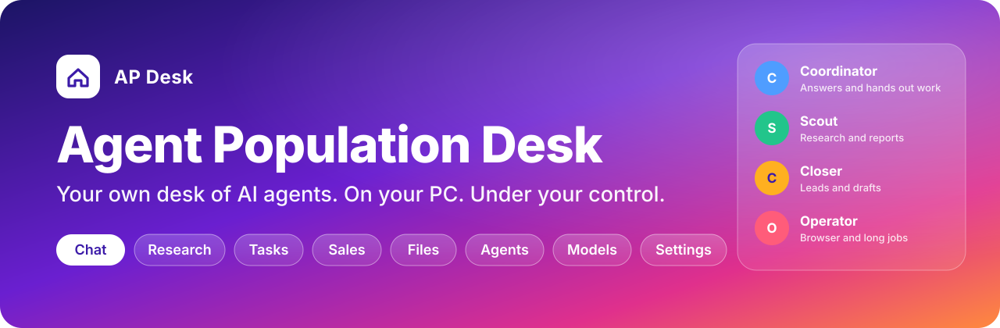
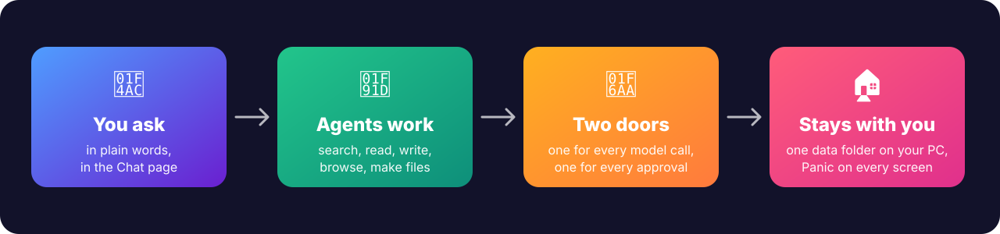
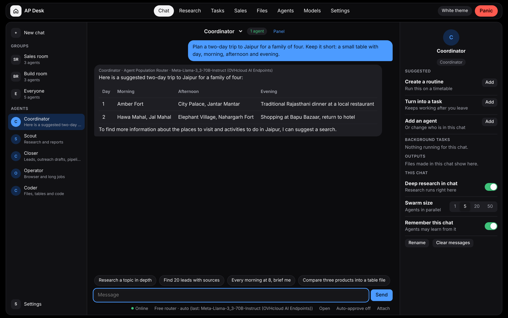
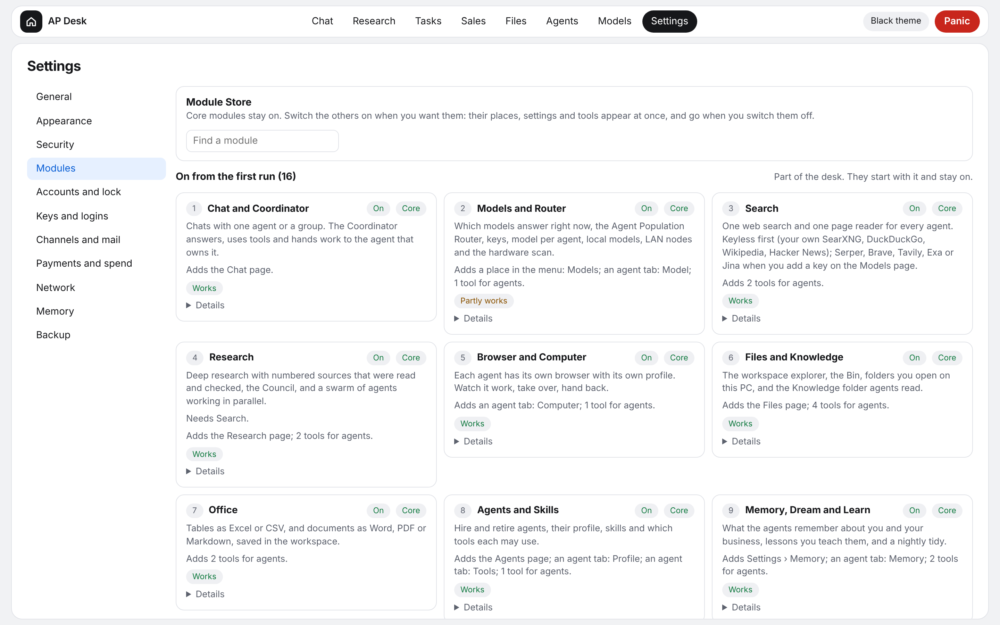
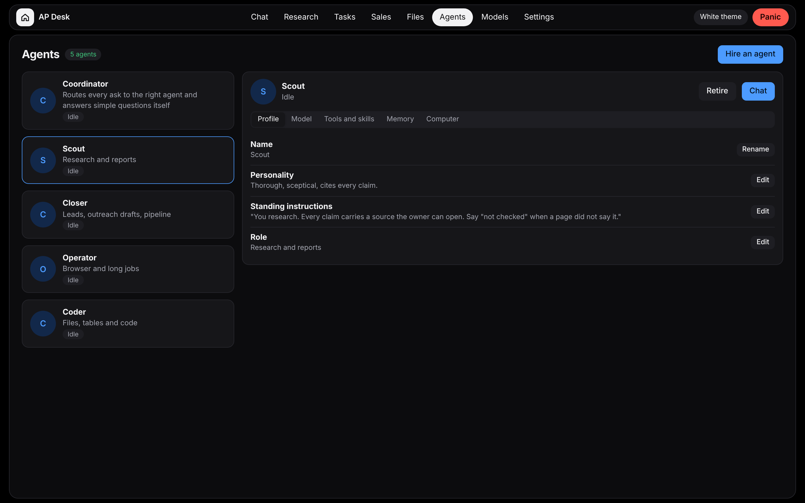
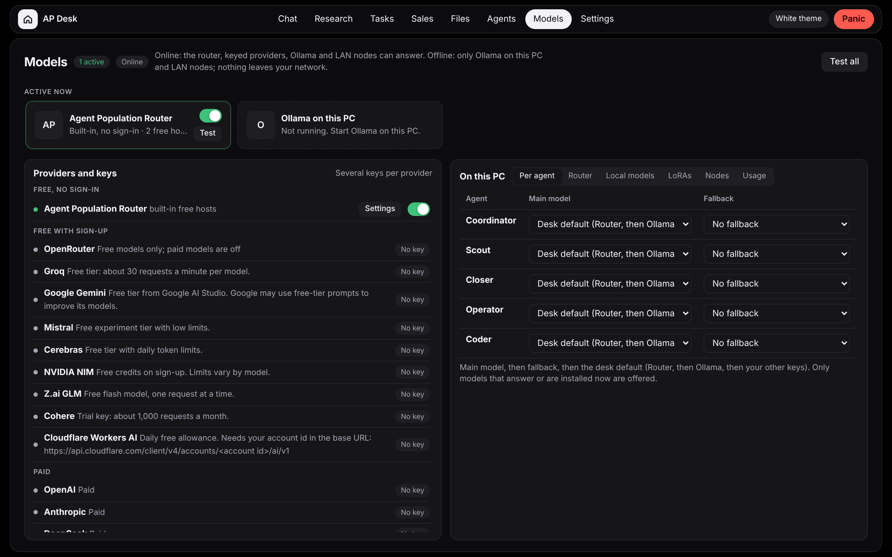

<p align="center">
  
</p>

<p align="center">
  <a href="LICENSE"></a>
  
  
  
  
  <a href="https://x.com/agentpopulation"></a>
</p>

<p align="center">
  <a href="https://agentpopulation.com"><b>Website</b></a> ·
  <a href="#-quick-start"><b>Quick start</b></a> ·
  <a href="#-what-is-in-it-for-you"><b>What it does</b></a> ·
  <a href="#-you-stay-in-charge"><b>Safety</b></a> ·
  <a href="#-honest-status"><b>Honest status</b></a> ·
  <a href="#-more-from-agentpopulation"><b>More from us</b></a>
</p>

# Agent Population Desk

**AP Desk** for short. A team of AI agents that lives on your own computer. You talk to it in plain words. It researches, finds leads, writes files, runs jobs on a timetable, and asks you before it does anything that matters.

## 👋 In plain words

Most AI tools are a chat box on someone else's server. AP Desk is a small office on your PC.

- **It runs at home.** One folder, one database file, one address that only your own computer can open: `http://127.0.0.1:3960`.
- **It is a team, not one bot.** A Coordinator takes your message and hands the work to the agent that owns it: Scout for research, Closer for sales, Operator for the browser and long jobs, Coder for files and tables. You can hire more.
- **It starts free.** It uses free models first and never spends money unless you switch that on.
- **You are the boss.** Nothing is sent to a person without your click, and a red **Panic** button on every screen stops everything at once.

<p align="center">
  
</p>

## 🎁 What is in it for you

| | You get | For example |
|---|---|---|
| 💬 | **A team you can talk to** | "Every morning at 8, brief me." "Rename these files." "Remind me on Friday." |
| 🔎 | **Research you can check** | Deep research with numbered sources. A source is kept only when the quoted words are found on the page that was read. |
| 📈 | **Sales help that waits for you** | Leads with the page each one came from, a four-stage pipeline, and outreach drafts. A draft goes out only when you approve that exact text. |
| 🗂️ | **Real files, not just chat** | Excel and CSV tables, Word, PDF and Markdown documents, saved in your workspace folder. |
| 🧠 | **A desk that learns you** | It remembers what you teach it, tidies its memory at night, and shows you what it kept. |
| 🧩 | **30 modules, switch on what you need** | 16 are on from the first run. 13 more wait in the Module Store. See the [full list](#-the-30-modules). |

### Things you can ask on day one

```text
Research the electric scooter market in India and give me a report with sources.
Find 20 leads for a payroll software company, with the page each one came from.
Compare three laptops into a table file.
Every morning at 8, brief me on my tasks and the weather.
Ask the Council: should we open a second office this year?
Draft an email to the first lead. I will approve it before it goes.
```

## 📸 A quick look

<p align="center">
  
</p>

<table>
  <tr>
    <td width="50%"></td>
    <td width="50%"></td>
  </tr>
  <tr>
    <td align="center"><sub>Module Store: every module shows its own honest status</sub></td>
    <td align="center"><sub>Agents: hire, retire, and choose a model for each</sub></td>
  </tr>
</table>

<sub>Screenshots taken from this code on 15 Nov 2026, on a fresh desk with no keys added. The chat reply is a real answer from a free model, not a mock-up.</sub>

## 🚀 Quick start

**One line, copy and paste.** Press the copy button on the line for your computer, paste it into a terminal, and press Enter. It downloads AP Desk into a new `apdesk-main` folder and starts it.

🪟 **Windows.** Open **Command Prompt** (press the Windows key, type `cmd`, press Enter) and paste:

```bat
curl -L -o apdesk.zip https://github.com/agentpopulation/apdesk/archive/refs/heads/main.zip && tar -xf apdesk.zip && cd apdesk-main && start.bat
```

🍎 **Mac** and 🐧 **Linux.** Open **Terminal** and paste:

```bash
curl -L https://github.com/agentpopulation/apdesk/archive/refs/heads/main.tar.gz | tar -xz && cd apdesk-main && ./start.sh
```

The first start installs the packages the desk needs, then opens it in your browser at `http://127.0.0.1:3960`. There is no build step.

**Next time**, start it with one file from that folder:

| Your computer | Start | Stop |
|---|---|---|
| 🪟 **Windows** | Double-click `start.bat` | Double-click `stop.bat` |
| 🍎 **Mac** | Double-click `start.command` | Press Ctrl+C in its window |
| 🐧 **Linux** | Run `./start.sh` | Press Ctrl+C in its window |

- **Node.js 22.13 or newer** is the one thing the desk needs. On Windows, `start.bat` installs it for you with winget. On Mac and Linux, get it from [nodejs.org](https://nodejs.org) first; the start file tells you if it is missing.
- **Prefer to click?** Press the green **Code** button on this page, choose **Download ZIP**, unzip it, and use the start file from the table.
- **On a Mac**, the first double-click may be stopped by macOS because the file came from the internet. Right-click `start.command`, choose **Open**, and confirm once.
- **If the window closes at once on Windows**, open Command Prompt in the folder, run `start.bat` there, and read the lines it prints.

<details>
<summary>For developers</summary>

```bash
git clone https://github.com/agentpopulation/apdesk.git
```

```bash
npm install
```

```bash
npm start
```

Then open `http://127.0.0.1:3960`. Run the tests with `npm test`.

</details>

**First five minutes**

1. Say hello in **Chat**. The Free API answers with no key and no sign-in.
2. Open **Models** to add your own keys, or point the desk at [Ollama](https://ollama.com) for fully local work.
3. Open **Settings › Modules** and switch on what you want: Mail, Calendar, Voice, Telegram, and more.
4. Try **Research** with a topic you know well, and check the sources it gives you.

## 🤖 Models: free first, your choice always

Every model call in the whole desk goes through one door, so one place decides what is used and what it may cost.

| Source | What it is | Cost |
|---|---|---|
| **Free API by Agent Population Desk** | Built in. Uses free models that need no sign-in. If you run your own router at `http://127.0.0.1:8787/v1`, the desk uses that. | Free |
| **Ollama** | Local models at `http://127.0.0.1:11434`. The only source used when you go Offline. | Free, on your hardware |
| **Your own keys** | OpenRouter, OpenAI, Anthropic, Groq, Gemini, or any OpenAI-compatible address. Typed in under Models. Several keys per provider. | Yours to decide |

<p align="center">
  
</p>

Free or paid is your choice. OpenRouter is used with **free models only** until you switch on "Paid models" beside its keys on the Models page. Only you can switch it, from the desk's own window.

Keys found in the environment when the desk starts are used for that run and are never written to disk: `OPENROUTER_API_KEY`, `OPENAI_API_KEY`, `ANTHROPIC_API_KEY`, `GROQ_API_KEY`, `GEMINI_API_KEY`, or `LLM_BASE_URL` with `LLM_API_KEY`.

## 🛡️ You stay in charge

- **Three security levels:** Open, Careful and Strict. They change only in Settings › Security. A chat message can never change them, and neither can an agent.
- **Nothing reaches a person without you.** Mail, messages and posts wait for your click on that exact item. If the text changes after you looked, it asks again.
- **Spending follows your limits.** Per item, per day and per month. The desk never pays by itself.
- **Panic** sits at the top right of every screen. One click stops every agent, job and browser. Nothing runs again until you press Resume.
- **Offline means offline.** Switch Online off and the desk itself refuses every outside call: search, browsing, mail and every online model. Only Ollama and model servers on your own network are used.
- **Your browser only.** The first browser that opens a fresh desk is remembered. Any other browser must type a six-digit code shown in the desk's own window.
- **A guard for hidden instructions.** Text from web pages and files is marked as untrusted before a model sees it, so a page cannot quietly give orders to your agents.

## 🧩 The 30 modules

**On from the first run (16)**

| # | Module | What it does |
|---|---|---|
| 1 | Chat and Coordinator | Chats with one agent or a group. The Coordinator answers, uses tools and hands work to the agent that owns it. |
| 2 | Models and Router | Which models answer right now, the router, keys, a model per agent, local models and a hardware scan. |
| 3 | Search | One web search and one page reader for every agent. Keyless first; Serper, Brave, Tavily, Exa or Jina when you add a key. |
| 4 | Research | Deep research with numbered sources that were read and checked, and a swarm of agents working in parallel. |
| 5 | Browser and Computer | Each agent has its own browser with its own profile. Watch it work, take over, hand back. |
| 6 | Files and Knowledge | The workspace explorer, the Bin, folders you open on this PC, and the Knowledge folder agents read. |
| 7 | Office | Tables as Excel or CSV, and documents as Word, PDF or Markdown. |
| 8 | Agents and Skills | Hire and retire agents, their profile, skills and which tools each may use. |
| 9 | Memory, Dream and Learn | What the agents remember about you, lessons you teach them, and a nightly tidy. |
| 10 | Council | Three seats answer, rank each other without names, and give one Verdict. |
| 11 | Tasks | Everything running, waiting for you and done. Tasks keep working when the browser is closed. |
| 12 | Flows and Schedules | Schedules that run on time in your zone, the morning brief, and chains of agents. |
| 13 | Sales | Leads with sources, a four-stage pipeline and outreach drafts that wait for you. |
| 14 | Safety | The security level, auto-approve, the waiting list, and the guard for hidden instructions. |
| 15 | Backup | Back up the database and workspace into one zip, restore it, and read the activity log. |
| 16 | Module Store | All 30 modules as cards: what each does, whether it is on, and its honest status. |

**Switch on when you want them (13)**

| # | Module | What it does |
|---|---|---|
| 17 | Mail | Inbox, drafts and allowed senders. Nothing is sent without you. |
| 18 | Calendar | Month, week, day and list, with `.ics` import and export. Agents ask before adding. |
| 19 | Social | Write posts for six networks and approve each one before it goes out. |
| 20 | Channels | Talk to your desk from Telegram, and get a push on ntfy when a job finishes. |
| 21 | Voice | Talk to the desk and hear it read aloud. |
| 22 | Vault and Logins | One place for keys and for site logins you save for agents' browsers. |
| 23 | Accounts and Lock | A screen lock with a PIN and optional two-step codes. |
| 24 | Payments and Spend | Spend limits and a log of every spend request. |
| 25 | Code and Sandbox | Run a short JavaScript or Python program in a sandbox folder. Always asks first. |
| 26 | Connect (MCP) | Add MCP servers. Their tools become tools your agents can use, when you tick them. |
| 27 | Network and OSINT | Speed test, devices on your network, and public lookups for a domain. |
| 28 | Life | Weather, a day plan for a trip with its sources, and exchange rates. |
| 29 | Studio | Build a small one-page website from a brief, and compare two models on a saved question. |

**Parked (1):** Looks (festival themes and avatar sets) is not built in this version.

## 📏 Honest status

This is version **0.1.0**, a first public release. We only state what was measured, with the date.

| What was measured | Result | When |
|---|---|---|
| Automated tests (`npm test`), Linux x64, Node 22 | 256 of 256 pass | 15 Nov 2026 |
| Start-up check (`node tools/smoke.mjs --quick`): every module loads and every page opens in a real browser | 30 modules found, 16 on, 13 switch on and off, 0 pages with problems | 15 Nov 2026 |
| 17 acceptance asks, answered by real free models, on this code | 13 passed, 3 failed, 1 not checked | 15 Nov 2026 |
| Safety probes in `tools/safety` | All hold, with one accepted limit listed below | 15 Nov 2026 |

The three that failed, and why:

- **Research report.** The report cited 15 sources and its sampled claims matched their pages, but a reader found one sentence about a different kind of solar cell quoted as if it were about the topic.
- **Compare table.** First run: no free model answered within 150 seconds. Second run: the file was made with 5 of 12 cells confirmed and 7 marked "not checked", and one of the runner's passage checks failed.
- **Lead search.** The desk listed 20 leads: 13 checked and 7 labelled "not checked". The test runner counted only one of the two tables, so it marked the ask as failed.

The ask that was not checked needs a local model through Ollama, which the test computer did not have.

**Known limits today**

- **No run has passed all 17 asks yet.** See the three above.
- **Research reports on free models can carry a wrong or off-topic sentence.** Every kept quote is found word for word on its page, but the desk does not yet check that the sentence is about your topic. Read the sources for anything that matters.
- **An ask to research something "in the background" can start two jobs for the same work.**
- **Local models through Ollama are wired but not checked.** No test run so far had Ollama installed.
- **Free models can be slow or busy.** The chat shows what it is waiting for, and a turn ends with a plain message if no model answers within 150 seconds.
- **PDF documents made by the desk leave out Hindi and other Indian-script text.** The built-in PDF font has no such letters. Seen on 15 Nov 2026.
- **Results change with the model that answers.** Weak free models call the wrong tool more often. Give an agent a stronger model for research, leads and tables.
- **Offline has edges.** It does not cover programs the desk starts as separate processes, or DNS lookups.
- **The code sandbox is not isolation** unless Docker is installed. Code you approve can read files on your PC, including the desk's own database. Its approval card says so, and the Code module is off until you switch it on.
- **A lead search lists some leads as "not checked".** Checked leads come first: a page it read places the company in your country and says it sells what you asked about. The rest are labelled "Country: not checked" or "What it sells: not checked". Some of those will be real fits.
- **After Panic, a module's own timer keeps ticking.** Everything it tries through the desk's doors is refused while halted.

The full list is in [`CHANGELOG.md`](CHANGELOG.md) under "Known weak points". Found something? Tell us on X.

## 🖥️ Where it runs

| Platform | State |
|---|---|
| Linux x64, Node 22 and 24 | Developed and tested here, including `start.sh`. |
| Windows 11 x64 | The main target. The one-line install was run on a Windows 11 PC on 20 Nov 2026: it downloaded, installed the packages, started all 16 default modules and opened the desk. The full set of acceptance asks has not been run on Windows. |
| Windows on ARM64 | Not tested. The desk is plain JavaScript with no native add-ons, so it should work. |
| macOS | Not tested yet. `start.command` uses the same script as Linux. |

The agents' browser uses the Edge or Chrome already installed on your computer.

## 🗺️ What is in the folder

| Path | What it holds |
|---|---|
| `app/` | The server, the shell, and the core doors: models, approvals, storage, modules. |
| `app/core/contracts/` | The four contracts every module follows. Start here if you want to build a module. |
| `modules/` | The 30 modules, one folder each, with a `module.json`. |
| `vendor/` | Browser builds of open-source code, with their licences. |
| `start.bat`, `start.command`, `start.sh` | One-file starters for Windows, Mac and Linux. |
| `setup/` | Windows first install and repair scripts, and the small checks the starters use. |
| `test/` | Automated tests for the core: the model door, the approval door, storage, modules and Panic. Each module keeps its own tests in its folder. Not needed to run the desk. |
| `tools/` | Developer checks, the acceptance asks, the safety probes and the zip builder. |
| `data/`, `backups/` | Made on first start. Your database, workspace and backup zips. Never committed. |


## 🌐 More from AgentPopulation

| Project | What it is |
|---|---|
| 🌍 [agentpopulation.com](https://agentpopulation.com) | The home of everything we build for AI agents. |
| 📦 [2 Million API Endpoint Pack](https://github.com/agentpopulation/2-million-api-endpoint-pack) | Lists of API endpoints that needed no key when tested, in five packs: weather, transit, water, finance and economy, and India. The name is a target, not a count. |
| 🧭 [APDesk Edge 63M](https://huggingface.co/agentpopulation/APDesk_63M) | A small model that routes each message, under Apache 2.0. Its weights are not published yet, and this release of AP Desk does not include it or need it. |

## 📜 Licence and credit

AP Desk is **open source** under the [Apache License 2.0](LICENSE). Copyright 2026 AgentPopulation.

It stands on the work of many open-source projects. Each one is listed with its licence in [`ATTRIBUTION.md`](ATTRIBUTION.md). Thank you to all of them.

## 💬 Contact

[@agentpopulation on X](https://x.com/agentpopulation). Questions, ideas and bug reports are all welcome there.
